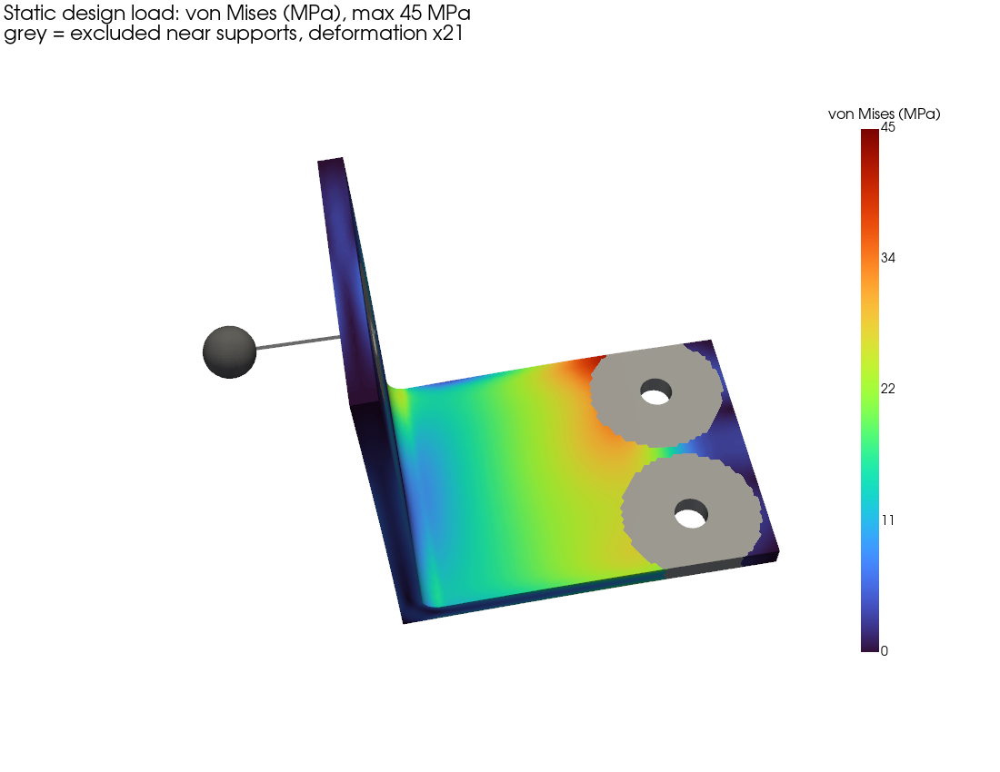
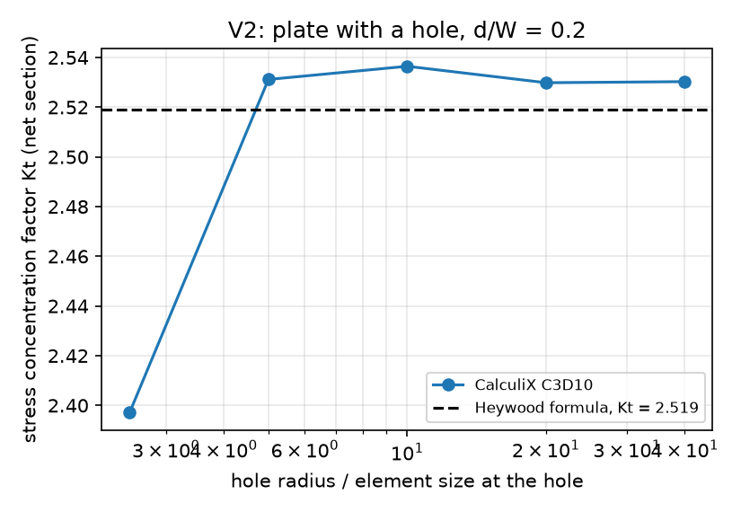
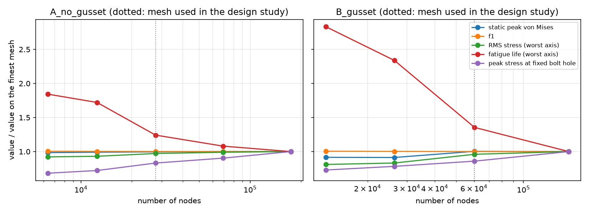
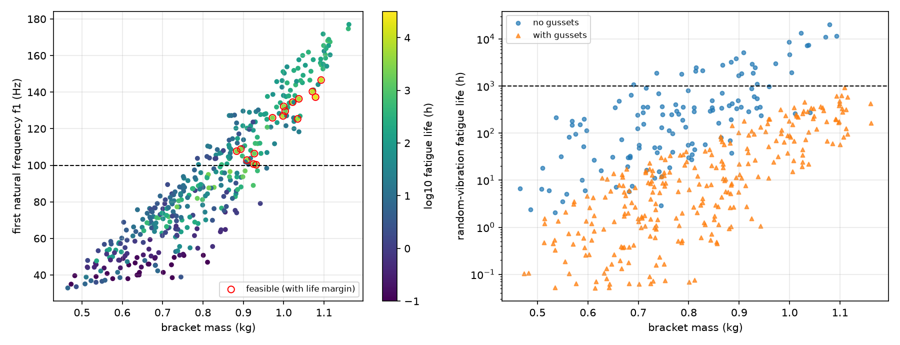
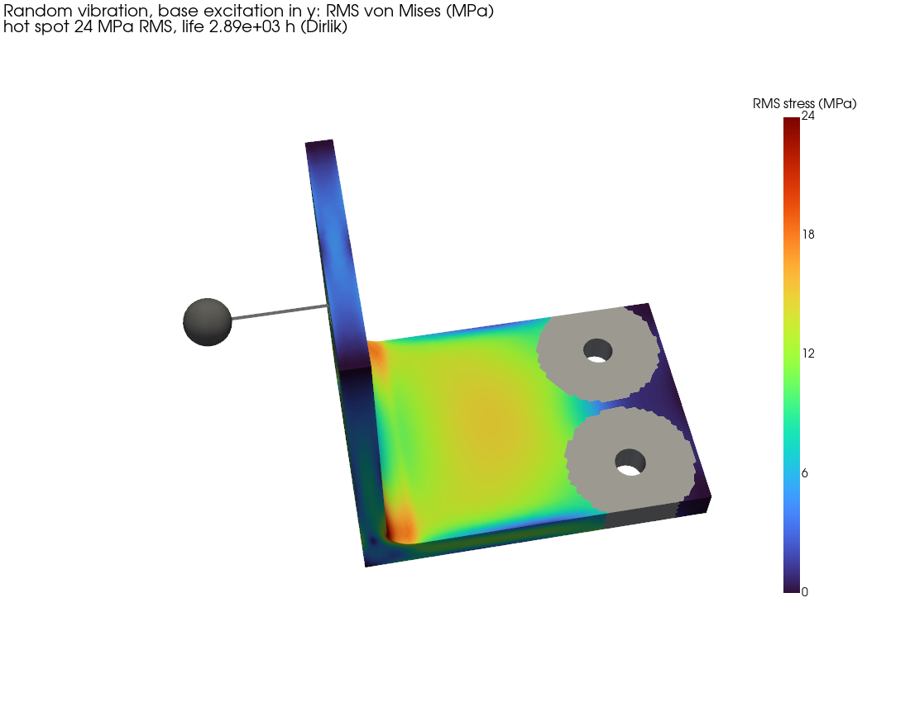
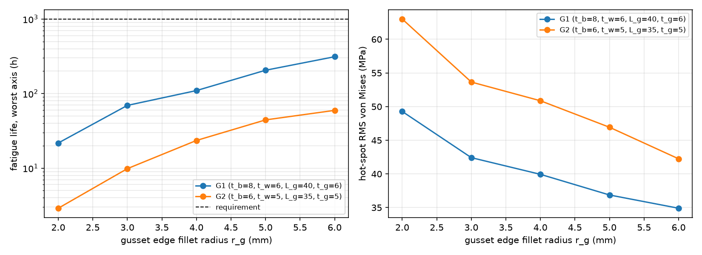

# Vibration fatigue design of an engine-mounted L-bracket (CalculiX FEA)

Static, modal, random-vibration and fatigue analysis of a parametric steel L-bracket that carries a
2 kg component, followed by a 400-design study to find the lightest bracket that meets stiffness and
fatigue requirements. Everything is scripted in Python and runs with open-source tools:
[gmsh](https://gmsh.info) (OpenCASCADE geometry and quadratic tet meshing) and
[CalculiX](http://www.calculix.de) 2.23 (an Abaqus-style solver; the input decks use `*STATIC`,
`*FREQUENCY`, `*STEADY STATE DYNAMICS`, `*RIGID BODY`, `*MASS`).

The dataset produced by the design study is also used to train a graph neural network surrogate
in the companion repository [`gnn-fea-surrogate`](https://github.com/RonHooo/gnn-fea-surrogate).



## Problem

| | |
|---|---|
| Geometry | L-bracket, 100 x 70 mm base, 100 mm upright, two M8 bolt holes, M10 mounting hole |
| Design variables | base thickness `t_b` 4-12 mm, upright thickness `t_w` 4-10 mm, inner fillet `r_f` 2-10 mm, two optional gussets (leg `L_g` 20-45 mm, thickness `t_g` 3-8 mm), optional lightening hole `d_h` 8-20 mm |
| Material | AISI 1020 hot-rolled steel, E = 207 GPa, S_y = 210 MPa, S_ut = 380 MPa |
| Component | 2 kg point mass, 30 mm in front of the upright, rigidly tied to the mounting hole |
| Supports | bolt hole surfaces fixed |
| Static load | 5 g fore-aft + 5 g lateral + 10 g vertical on bracket and component |
| Random vibration | base excitation, flat 0.02 g²/Hz from 20 to 1000 Hz (4.4 g RMS), each axis separately, 2 % modal damping |
| Requirements | peak von Mises <= S_y / 1.5 = 140 MPa; f1 >= 100 Hz; fatigue life >= 1000 h (worst axis) |

These loads and requirements are assumptions for a representative engine-mounted bracket, not a
real product specification. Fatigue life scales with the input PSD level to the power -m/2 = -3.8,
so the absolute hours matter less than the comparison between designs.

## Method

1. **Geometry and mesh** (`bracketfea/geometry.py`): parametric solid built with OpenCASCADE booleans;
   the gusset attachment edges get 2 mm fillets so there are no re-entrant sharp edges. Quadratic
   tetrahedra (C3D10), refined at fillets and holes, about two elements through the thinnest plate.
2. **CalculiX deck** (`bracketfea/ccx.py`): static step, then 10 modes (`*FREQUENCY`). The component is a
   `*MASS` element tied to the mounting hole with `*RIGID BODY`.
3. **Random vibration** (`bracketfea/vibration.py`): base-excitation response by modal superposition
   with the participation factors and modal stresses from CalculiX. The stress PSD at every surface
   node is the equivalent von Mises PSD of Preumont and Piéfort (1994).
4. **Fatigue** (`bracketfea/fatigue.py`): S-N curve from the Shigley method (surface and size factors,
   extended below the endurance limit for random loading), Dirlik's rainflow-range distribution and
   Miner's rule. Narrow-band and Steinberg three-band estimates are reported for comparison.
5. **Stress evaluation region**: stresses within 2 bolt diameters of the bolt axes and 1.5 hole
   diameters of the mounting hole are not used. The fixed supports and the rigid coupling are
   idealisations; the peak stress there grows without bound as the mesh is refined (see below).
   The bolted joint itself would be checked separately.

## Verification

| Check | Reference | Result |
|---|---|---|
| Cantilever tip deflection (V1) | Timoshenko beam | -0.6 % |
| Cantilever mid-span bending stress (V1) | beam theory | +0.01 % |
| Cantilever bending frequencies f1, f2, lateral f1 (V1) | Euler-Bernoulli | +0.2 %, -0.9 %, -0.5 % |
| Cantilever + tip mass on a rigid end face (V1) | exact frequency equation | +0.2 % |
| Plate with hole, d/W = 0.2 (V2) | Heywood formula, Kt = 2.519 | Kt = 2.530 (+0.4 %) |
| Modal superposition code vs CalculiX `*STEADY STATE DYNAMICS` (V3) | CalculiX | < 0.001 % of peak |
| 10-mode quasi-static sum vs direct static 1 g (V3) | CalculiX static | 0.2-0.4 % at hot spot |
| Dirlik vs rainflow counting of synthesized signals (V3) | time domain | -3 % (narrow band), +22 % (bimodal), -5 % (bracket hot spot) |
| Base plate bending stress of the bracket (hand calc) | beam theory at x = 40, 50 mm | -0.8 % |



**Mesh convergence** (`studies/mesh_convergence.py`). On the design-study mesh the static peak stress
and f1 are within 0.5 % and 0.1 % of the finest mesh. The RMS stress at the hot spot is 3-4 % low,
which makes the fatigue life 20-35 % too long because life ~ stress^-7.65. The design study therefore
uses a life margin of 1.5, and the selected design is re-checked on a finer mesh. The peak stress at the
fixed bolt hole does not converge (95 -> 139 MPa), which is the expected support singularity.



## Results

### Design study (400 designs, Latin hypercube)

About 8.5 CPU-hours of CalculiX runs (25k-183k nodes per design). Every design passed the static
check (largest peak 122 MPa vs 140 MPa allowed), so the design is driven by vibration:

| Requirement | Designs that pass |
|---|---|
| static, von Mises <= 140 MPa | 400 / 400 |
| f1 >= 100 Hz | 145 / 400 |
| fatigue life >= 1000 h | 26 / 400 |
| all three | 17 / 400 (16 with the 1.5 life margin) |



* **Base plate thickness controls both stiffness and fatigue.** Spearman correlation with f1 is 0.93
  and with log life 0.66; the upright thickness follows (0.36 and 0.32).
* **Gussets raised f1 but lowered fatigue life.** None of the 272 designs with gussets met the
  fatigue requirement (correlation of gusset size with log life: -0.43). In 154 of them the peak
  static stress sits at the gusset toe on the base plate, which is a stress raiser on a plate that bends.

### Selected design

| | baseline | thinnest plain bracket that passes | lightest feasible DOE design |
|---|---|---|---|
| t_b / t_w / r_f (mm) | 6 / 6 / 5 | 9 / 9 / 5 | 9.9 / 7.1 / 8.6, 9.7 mm lightening hole |
| mass (kg) | 0.632 | 0.932 | **0.884** |
| f1 (Hz) | 57 | 104 | 108 |
| fatigue life, worst axis (h) | 163 | 1,659 | 3,262 (2,894 on a finer mesh with 2.5x the nodes) |
| feasible | no | yes | yes |

The selected design is 5 % lighter than simply thickening both plates. Its fatigue hot spot is at the
ends of the inner fillet under lateral (y) excitation:



### Two follow-up checks

**Gusset detail.** With the rest of the geometry fixed, increasing the fillet radius on the gusset
edges from 2 to 6 mm raised the fatigue life 14x (21.7 -> 312 h) and 20x (2.9 -> 59.5 h) for two
gusseted designs, for +2 % mass. Both stay below 1000 h, because the toe still ends on the bending base
plate. A gusset that is meant to help fatigue would need to run closer to the bolts.



**Size of the excluded bolt zone.** Changing the excluded radius from 1.5 to 3 bolt diameters changes
the static peak of the plain t = 9 bracket from 21.2 to 16.5 MPa, but does not change the fatigue life
of either the selected or the plain design: the fatigue hot spot is at the fillet, away from the bolts.

## Reproduce

```bash
python -m venv .venv && .venv/bin/pip install numpy scipy matplotlib gmsh pyvista pandas rainflow pytest
# CalculiX: FreeCAD ships ccx (brew install --cask freecad), or set CCX_PATH
PYTHONPATH=. .venv/bin/python -m pytest tests
PYTHONPATH=. .venv/bin/python verification/v1_cantilever.py
PYTHONPATH=. .venv/bin/python verification/v2_plate_hole.py
PYTHONPATH=. .venv/bin/python verification/v3_vibration_fatigue.py
PYTHONPATH=. .venv/bin/python studies/mesh_convergence.py
PYTHONPATH=.:studies .venv/bin/python studies/doe.py --workers 3
PYTHONPATH=. .venv/bin/python studies/hand_calcs.py
PYTHONPATH=. .venv/bin/python studies/plot_verification.py
PYTHONPATH=. .venv/bin/python studies/optimize.py              # DOE analysis, plain reference, fine-mesh check
PYTHONPATH=. .venv/bin/python studies/gusset_detail.py
PYTHONPATH=. .venv/bin/python studies/exclusion_sensitivity.py
PYTHONPATH=. .venv/bin/python studies/design_report.py --name baseline
```

The design study (plus 40 OOD designs) took under 3 hours with 4 parallel jobs on a 16 GB M3 MacBook;
more parallel jobs ran out of memory.

## Limitations

* Linear elastic, small deflections; bolted joint and contact are not modelled.
* The component is a point mass (no rotary inertia) on a rigid hole.
* Fatigue: no mean-stress correction (the static 1 g stress is small), no weld or surface-finish
  details beyond the Shigley factors, damping assumed (2 %).
* The design study uses a mesh that over-predicts life by 20-35 %; see the margin above.
